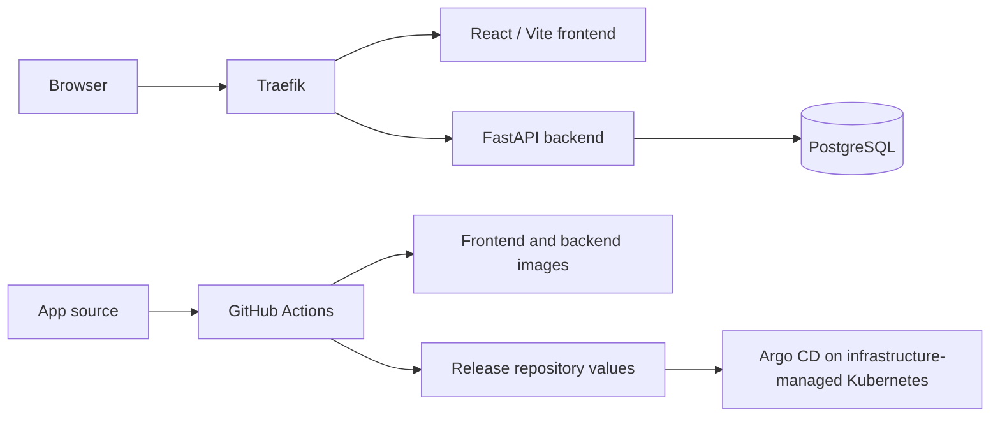

# FastAPI Project App

The application repository of the **DataScientest Group 25 bootcamp team project**:
a FastAPI backend, React/TypeScript frontend and PostgreSQL-backed user/item flows.
The team used this application to practise containerisation and a three-repository
GitOps delivery approach. This is training-project source, not a live-service or
production-readiness guarantee.

## Team ownership and companion repositories

This is shared team work; this README does not attribute the application or the
whole CI/CD pipeline to one contributor. For Oluwatoyin Balogun's confirmed
infrastructure responsibilities and linked commit evidence, see the
[infrastructure README](https://github.com/datascientest-fastAPI-project-group-25/fastAPI-project-infra#contribution-and-team-context).

| Repository | Role |
| --- | --- |
| **app (here)** | Application source, tests, local Compose stack and image workflows |
| [release](https://github.com/datascientest-fastAPI-project-group-25/fastAPI-project-release) | Helm chart and environment-specific image values |
| [infra](https://github.com/datascientest-fastAPI-project-group-25/fastAPI-project-infra) | Terraform/AWS/EKS, state, IAM and Argo CD foundations |

## Architecture



The local routing is declared in [`docker-compose.yml`](docker-compose.yml) and
[`traefik/`](traefik/). Kubernetes templates live in the release repository, not
in this app tree. The diagram describes source relationships, not a freshly tested
image-build-to-cluster deployment.

### Source map

| Path | Contents |
| --- | --- |
| [`backend/app/main.py`](backend/app/main.py) | FastAPI entry point, routing, middleware and health endpoints |
| [`backend/app/api/routes/`](backend/app/api/routes/) | Login, users, items and utility endpoints |
| [`backend/app/core/config.py`](backend/app/core/config.py) | Settings and required environment variables |
| [`backend/tests/`](backend/tests/) | API, CRUD, unit and integration tests |
| [`frontend/src/`](frontend/src/) | React UI, routes, generated API client and component tests |
| [`frontend/tests/`](frontend/tests/) | Playwright browser tests |
| [`docker-compose.yml`](docker-compose.yml) | Development services, volumes and startup commands |
| [Build staging images](.github/workflows/build-stg-image.yml) / [production images](.github/workflows/build-prod-image.yml) | Staging builds and production retagging/release flow |
| [Release dispatch](.github/workflows/trigger-helm-release.yml) | Sends an `app-release` event to the companion release repo |

## Start with offline validation

```bash
git clone https://github.com/datascientest-fastAPI-project-group-25/fastAPI-project-app.git
cd fastAPI-project-app
```

The documentation change follows the team's `stg` integration branch. Its review
baseline is `97f95fa`; `main` was `37450f4`. When comparing results, use the same
revision. Python **3.11** is required by `backend/pyproject.toml` for running the
application. The following syntax-only check also ran successfully with Python
3.13; that is not a claim that application dependencies support Python 3.13.

```bash
python3 - <<'PY'
import ast
import json
from pathlib import Path
files = sorted(Path("backend").rglob("*.py"))
for path in files:
    ast.parse(path.read_text(), filename=str(path))
for name in ("package.json", "frontend/package.json"):
    json.loads(Path(name).read_text())
print(f"Parsed {len(files)} backend Python files and 2 package manifests")
PY
```

For YAML syntax checking, use Python 3 with PyYAML installed in a trusted isolated
environment (the review used PyYAML 6.0.3):

```bash
python3 - <<'PY'
from pathlib import Path
import subprocess
import yaml
paths = subprocess.check_output(["git", "ls-files"], text=True).splitlines()
files = [Path(p) for p in paths if p.endswith((".yml", ".yaml"))
         and not p.startswith("charts/fastapi/templates/") and not Path(p).is_symlink()]
for path in files:
    list(yaml.safe_load_all(path.read_text()))
print(f"Parsed {len(files)} YAML files (Helm templates excluded)")
PY
```

**Observed:** 66 backend Python files, two package manifests and 39 YAML files
parsed. No app code was imported by these checks. Python syntax and YAML parsing
are not application, Compose-schema, security or end-to-end tests.

## Runtime setup prerequisites and validation gates

For runtime work, use an isolated development machine with Python 3.11, `uv`,
Node.js (see [`frontend/.nvmrc`](frontend/.nvmrc)), pnpm (root package metadata
specifies 10.7.0), Docker and Compose. Read the scripts and Dockerfiles before
running setup: Compose startup installs dependencies and mounts the checkout.
Do not run it against a real deployment or a database containing valuable data.

1. Review [`.env.example`](.env.example) and create a local, untracked `.env` with
   unique development-only values. Settings require `PROJECT_NAME`,
   `POSTGRES_SERVER`, `POSTGRES_USER`, `FIRST_SUPERUSER` and
   `FIRST_SUPERUSER_PASSWORD`; configure the database/password, signing secret and
   frontend origin consistently. Never reuse checked-in sample credentials.
2. Follow the [development guide](docs/development/guide.md) and component guides
   below, inspecting their commands against the current Makefile and manifests.
   `make setup`, hook installers and container startup are **not** part of the
   read-only validation above.
3. After reviewing and installing dependencies in isolation, run backend pytest
   against disposable test data; run the frontend `test` script (Vitest) and then
   `test:e2e` (Playwright) with its configured browser/service prerequisites.
   See [backend testing](backend/tests/README.md) and
   [frontend testing](frontend/src/test/README.md).
4. Verify a real HTTP request to `/health` and `/docs`, then exercise login and
   item CRUD against a disposable database. A parsed file or built image does
   not establish these behaviours work.

**Not run in this documentation review:** dependency installation, app startup,
pytest, Vitest, Playwright, Docker builds or deployments. The clean checkout had
no frontend dependencies, and the inspected Python environment had no pytest,
FastAPI or SQLModel. The backend test fixture drops/recreates test tables, so it
must never be pointed at a valuable database. No AWS or Kubernetes access is
needed for the offline checks.

### Known baseline limitations

- `PLAN.md` and `scripts/git/block-main-push.py` are broken tracked symlinks in a
  fresh clone; setup/hook commands referencing them need maintainer review.
- Some old docs describe scripts or guarantees not established by this review.
  Existing open PR #294 also changes the README alongside monitoring/code changes;
  maintainers should reconcile overlap rather than merging it blindly.
- Public historical revisions contain secret-bearing configuration findings.
  Maintainers need to assess rotation and history cleanup; deleting a file from
  the current tree is not revocation. Do not copy historical credentials or
  republish the ancestry into a new portfolio repository.
- The release/infra value-file and Argo namespace integration needs reconciliation;
  see their READMEs. A functioning current AWS environment was not verified.

## Team workflow and documentation

The documented promotion route is feature/fix branch → `stg` → `main`. Use scoped
PRs and maintainers' review; merging to integration/release branches can trigger
image publication and downstream release automation. This README PR is not a
request to merge, deploy or repair CI. Validation status must remain explicit.

The detailed team documentation remains available:

- [Development guide](docs/development/guide.md) and [Makefile reference](docs/development/makefile.md)
- [Backend](backend/README.md) and [frontend](frontend/README.md) guides
- [Deployment guide](docs/deployment/guide.md)
- [GitHub Actions](docs/workflows/github-actions.md) and [CI/CD workflow](docs/ci-cd-workflow.md)
- [Git hooks](docs/git-hooks.md) and [branching strategy](docs/BRANCHING_STRATEGY.md)
- [Version management](docs/VERSION-MANAGEMENT.md) and [release notes](docs/release-notes.md)
- [Documentation index](docs/README.md)
- [Earlier README with detailed command tables](https://github.com/datascientest-fastAPI-project-group-25/fastAPI-project-app/blob/97f95fa/README.md) — historical reference; inspect before execution

For troubleshooting, check the configured database target, frontend API URL,
CORS settings and service health before resetting anything. Commands such as
`docker compose down -v` delete local data; they are not a safe first diagnostic.
See [LICENSE](LICENSE).
